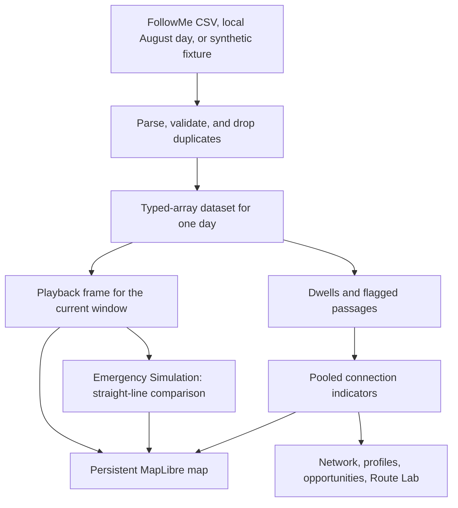

# How SeaPulse works

SeaPulse replays historical FollowMe vessel tracks on a map. You load one day, watch where those trackers reported, inspect connections inferred from the same positions, and compare hypothetical travel times. Nothing in the app is a live vessel feed.

Setup and the three sections are in [README.md](README.md). Module detail is in [IMPLEMENTATION.md](IMPLEMENTATION.md). What the files cannot support is in [LIMITATIONS.md](LIMITATIONS.md).

## What SeaPulse does

A researcher or teammate opens one FollowMe CSV in the browser. SeaPulse keeps the positions, plays them forward through a time window, and draws activity on a map of the Maldives. From the same day it estimates where vessels lingered and which areas they travelled between. Network compares those historical measurements with times the user wants to test. Emergency Simulation, under Experimental, does the same for a hypothetical incident. The result is an exploration tool for the August 2025 extract, not a picture of every boat in the country.

## System flow

Parsing prefers a Web Worker and falls back to the same function on the main thread. The browser keeps the active day and one previous day. Switching Explore, Network, and Emergency Simulation does not reload the file.

## Application flow

The map, the loaded day, and the playback clock stay mounted. Only the sidebar changes.

**Explore** is where a file is loaded. It shows day quality, a vessel list, and activity cells for the current window. Positions here are tracker reports from the file.

**Network** lists observed connections. The loaded day is one window. The August summary, when it has been built locally, is another, and the screen says which. Find opportunities is the primary action on that screen. It applies the rules in [CONNECTIVITY_METHOD.md](CONNECTIVITY_METHOD.md), including journeys that are far longer than usual, and holds back small samples. A flagged journey can be replayed with the existing clock. Route Lab compares a typed hypothetical with the observed typical time. A cluster on the map opens a place profile. Named places appear only when a geography file is loaded. A profile shows Census 2022 residents only when the island matches an official atoll and English name. Ambiguous and unmatched places stay blank. The Team Guide in the header walks through this path. See [TOUR.md](TOUR.md).

**Emergency Simulation** is under the Experimental menu, at `/simulate`. It places a hypothetical incident on the map and ranks historical positions by straight-line time. It does not send a vessel. Historical positions are not live positions, and a tracked vessel is not a rescue asset.

`/` and `/explorer` redirect to `/explore`, `/emergency` to `/simulate`, and `/routes` to `/network?tab=routes`.

## Technical architecture

**Dataset loading.** Explore reads a CSV in the browser, or, in development only, streams one file from `data/FollowMe/FollowMe_august_2025`. Production returns 404 for that route. The parser accepts named FollowMe headers or the original column positions, keeps rows inside the Maldives box, and stores columns in typed arrays.

**Shared React state.** `MaritimeContext` holds the dataset, geography, journeys, and links, and separates playback settings from the moving clock. `WorkspaceContext` holds the sidebar, details card, layer toggles, and scenario drafts. Section markers reach the map through a small overlay store so a route change does not rebuild the map.

**Persistent MapLibre map.** `MapStage` owns one map for the whole workspace. Panels publish markers and lines onto it. The CARTO basemap is recolored for the active theme. If that style fails, the data layers still draw.

**Playback engine.** The bar under the map moves a millisecond cursor. At 1× the clock advances by one sixth of the window every 90 ms. The frame keeps the last ping per device in `[t − W, t + 1)`, hub cells for that window, and the selected trail. Faster speeds take fewer samples. They do not change a vessel’s reported speed.

**Analysis utilities.** After a day loads, dwell detection groups slow pings and passages measure the gap between dwells on the same device. Credible durations are pooled. The month file is an offline aggregate, not a sum of daily medians. A jump faster than 40 knots, a clock that does not move, or a report gap over 30 minutes stays out of the typical time and stays in the coverage count. A passage whose ends fall on the same named island is counted and left out of the inter-island list. Header search, the Frequency tab, and CSV export read those aggregates. Export does not include coordinates or device identifiers.

**Scenario calculations.** Route Lab compares a typed duration with the observed typical time and says what evidence is still missing. Simulate uses straight-line distance and is marked experimental. A medical leg is added only when a loaded place is marked medical and verified. Population comes from Maldives Bureau of Statistics Table P5 (Census 2022) after `npm run data:census`. A match needs an official island code, the same atoll plus English name, or a name that is unique on both sides. It is context beside the journeys, not a demand model and not an isolation score.

## Data classifications

**Observed GPS data** is what the file recorded: time, latitude, longitude, reported speed, and the other tracker fields that were present. Summaries such as trip count and median duration describe those records.

**Derived or inferred findings** are calculated from the pings. Hub cells count devices in a grid. Dwells and activity areas estimate lingering. Links estimate travel between those areas. An activity cell is not a harbour, and a cluster of pings is not an island name.

**Hypothetical simulations** are choices the user adds: a typed duration, a clicked incident, an assumed speed, or a Coast Guard origin that was not in the file. The interface labels these as hypothetical. The synthetic fixture in `public/fixtures/` is test geometry, not an observation.

## Limitations

SeaPulse does not monitor vessels live and it is not a Coast Guard dispatch system. Coverage is only the trackers in the loaded file. Distance is straight-line. The speed unit is not documented in the extract. A fuller list is in [LIMITATIONS.md](LIMITATIONS.md).
